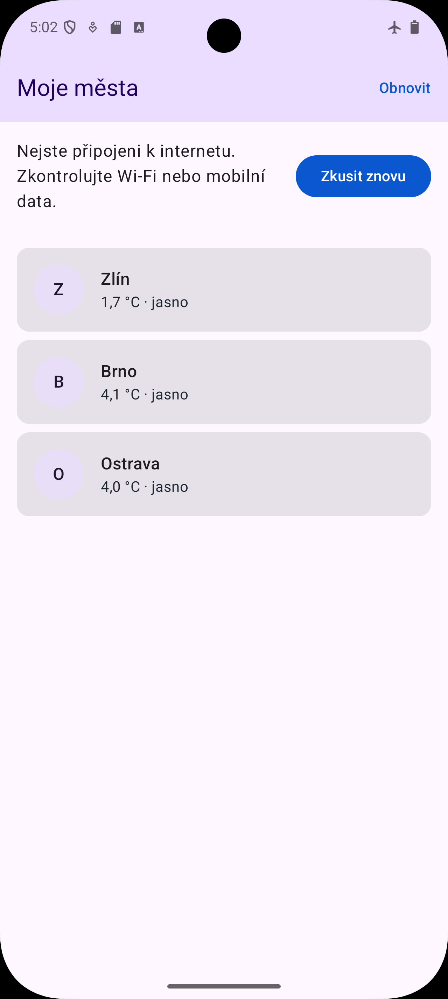
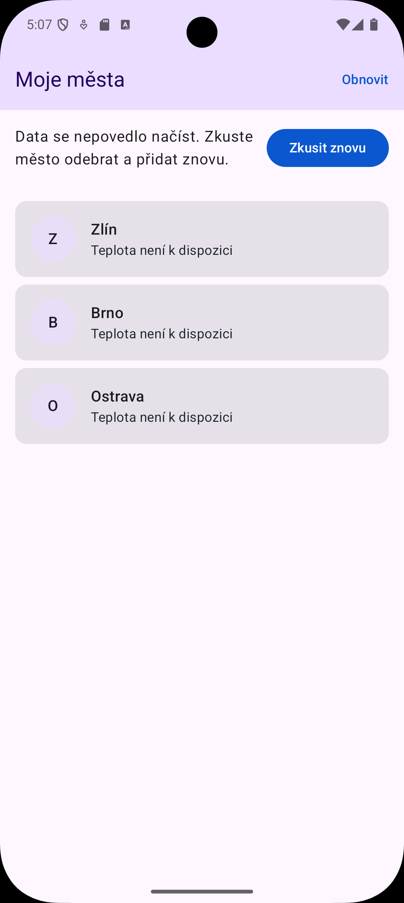

# Lekce 11 – doklady

## 11.1 Skutečná data z Open-Meteo
- URL: https://api.open-meteo.com/v1/forecast?latitude=49.2265&longitude=17.6683&current=temperature_2m%2Crelative_humidity_2m%2Cweather_code%2Cwind_speed_10m&timezone=auto
- Kód: 200, doba: 29 ms, velikost: 312 B, content-type: application/json; charset=utf-8
- Srovnání s curl (Zlín): curl 3,2 °C, aplikace 2,4 °C
- Detail města bere počasí z cache Repository: po otevření detailu nepřibyl žádný požadavek.

## 11.2 Tři stavy a tři různé chyby
Stavy: načítání (lineární indikátor nad seznamem), úspěch, chyba s tlačítkem Zkusit znovu.
Data, která už byla načtena, se při chybě neschovávají.

| Chyba | Jak vyvolána | Důvod | Hláška | Logcat |
|---|---|---|---|---|
| A | letadlový režim | BEZ_PRIPOJENI | Nejste připojeni k internetu. Zkontrolujte Wi-Fi nebo mobilní data. | `<-- HTTP FAILED: java.net.UnknownHostException: Unable to resolve host "api.open-meteo.com": No address associated with hostname.` (2 ms) |
| B | `readTimeout(1, TimeUnit.MILLISECONDS)` v `Sit.kt` | SERVER_NEODPOVIDA | Server neodpovídá. Zkuste to prosím za chvíli. | `<-- HTTP FAILED: java.net.SocketTimeoutException: Read timed out.` (24 ms) |
| C | `@GET("v1/neexistuje")` v `MeteoApi.kt` | CHYBA_POZADAVKU | Data se nepovedlo načíst. Zkuste město odebrat a přidat znovu. | `<-- 404 Not Found https://api.open-meteo.com/v1/neexistuje?...` (21 ms) |

Po vypnutí letadlového režimu tlačítko Zkusit znovu data načetlo.
Hlášky A–C jsou různé, protože každá chyba skončí v jiné větvi `bezpecneVolani`: UnknownHostException, SocketTimeoutException a HttpException (kód 404).
Letadlový režim a špatná doména (.invalid) by daly stejnou hlášku, protože obojí je UnknownHostException. Hláška "nejste připojeni" tedy ještě neznamená, že je uživatel offline.

### Snímky

**A – letadlový režim (BEZ_PRIPOJENI)**

**B – timeout (SERVER_NEODPOVIDA)**

**C – špatná cesta, 404 (CHYBA_POZADAVKU)**
