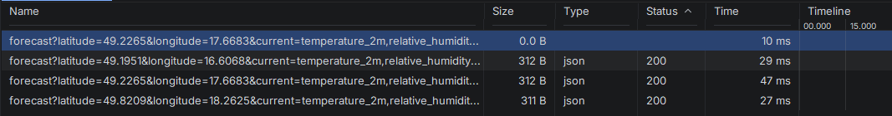
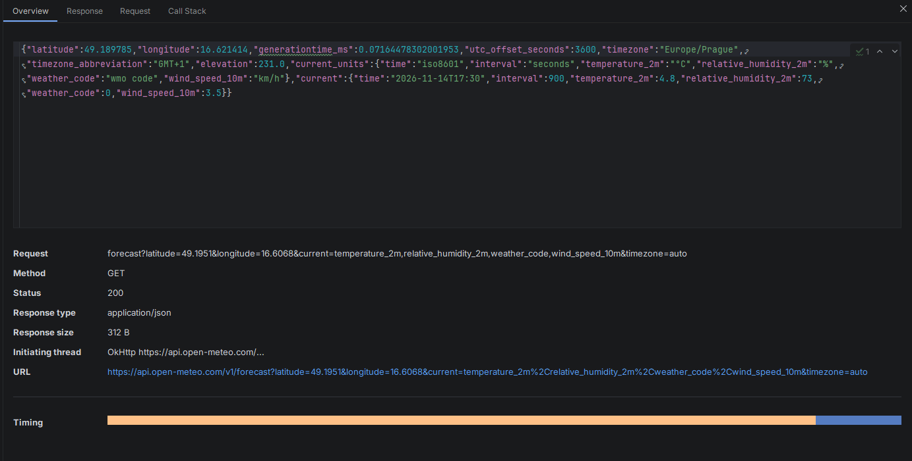

# Lekce 11 – doklady

## 11.1 Skutečná data z Open-Meteo
- URL: https://api.open-meteo.com/v1/forecast?latitude=49.2265&longitude=17.6683&current=temperature_2m%2Crelative_humidity_2m%2Cweather_code%2Cwind_speed_10m&timezone=auto
- Kód: 200, doba: 29 ms, velikost: 312 B, content-type: application/json; charset=utf-8
- Srovnání s curl (Zlín): curl 3,2 °C, aplikace 2,4 °C
- Detail města bere počasí z cache Repository: po otevření detailu nepřibyl žádný požadavek.

