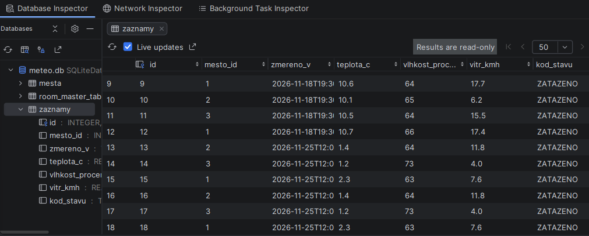
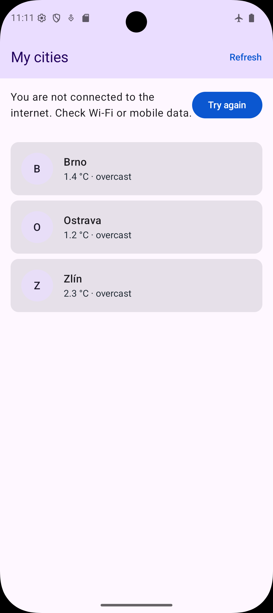

# Lekce 12 – doklady

## 12.1 Room s Flow a Hilt
- Databáze `meteo.db` (Room, `version = 1`, `exportSchema = true`), schéma je v `app/schemas/cz.utb.meteodenik.data.local.MeteoDatabaze/1.json`.
- Tabulky: `mesta` (primární klíč `id`, unikátní index na `nazev`, sloupce `zem_sirka`, `zem_delka`) a `zaznamy` (primární klíč `id`, cizí klíč `mesto_id` s `ON DELETE CASCADE`, index na `mesto_id`).
- `MestoDao`: čtení `sledujMestaSMerenimi(): Flow<List<MestoSMerenimi>>`, zápis a mazání jsou `suspend` (`vlozMesto`, `ulozZaznam`, `smazMesto`).
- Hilt: `@HiltAndroidApp` (`MeteoAplikace`, zapsaná v manifestu), `@AndroidEntryPoint` (`MainActivity`), moduly `DatabazeModul` (`@Singleton` databáze, DAO), `SitModul` (Retrofit, `MeteoApi`), `RepositoryModul` (`@Binds` `MeteoRepository`). ViewModely jsou `@HiltViewModel` a v obrazovkách se berou přes `hiltViewModel()`.
- Výchozí tři města (Zlín, Brno, Ostrava) se vloží jednorázově callbackem při prvním vytvoření databáze, v kódu už není žádný seznam, který by byl zdrojem dat.
- Logcat (filtr `MeteoDb`): „Vytvářím instanci databáze“ se při spuštění objeví jednou, takže databáze je singleton.

### Database Inspector
V tabulce `zaznamy` se se zapnutými Live updates po klepnutí na Obnovit objevily nové řádky bez jakéhokoli ručního obnovení. Řádky z 18. 11. 2026, kdy aplikace běžela poprvé, v tabulce zůstaly i po restartu aplikace.

## 12.2 Repository na offline-first
- `MeteoRepository` má dvě oddělené části: `sledujMesta(): Flow<…>` čte jen z Roomu, `obnovPocasi(): DuvodSelhani?` stáhne data ze sítě, zapíše je do databáze a vrací jen případný důvod selhání, ne data.
- Zápis do databáze probíhá jen ve větvi `Uspech`, při chybě sítě se nezapisuje nic.
- Cache v paměti z lekce 11 je smazaná, nahradila ji databáze.
- `MestaViewModel` skládá stav přes `combine(repository.sledujMesta(), stavAkce)` a `stateIn(…, WhileSubscribed(5_000), …)`.
- Importy: ve `ui/` není žádný import `androidx.room`, `retrofit2`, `data.local` ani `data.remote`.

### Offline scénář
| Krok | Co jsem udělal | Výsledek                                                                                     |
|---|---|----------------------------------------------------------------------------------------------|
| 1 | spustil aplikaci se sítí | seznam měst s teplotami                                                                      |
| 2 | zapnul letadlový režim v emulátoru | –                                                                                            |
| 3 | v Android Studiu Stop a znovu Run | seznam s posledními teplotami a nad ním hláška o chybě (BEZ_PRIPOJENI), ne prázdná obrazovka |
| 4 | vypnul letadlový režim, klepl na Obnovit | teploty se aktualizovaly, nezměnily                                                          |
| 5 | znovu zapnul letadlo a restartoval aplikaci | data zůstala                                                                                 |

## Vysvětlení

**Proč je čtení z DAO `Flow` a zápis `suspend`?**

 chci sledovat, takže po každé změně tabulky Room pošle nový výsledek a seznam se doplní sám. Zápis je jednorázová práce s diskem, proto je `suspend`: počká a nezablokuje hlavní vlákno. Kdyby čtení bylo `suspend fun …: List`, dostal bych jen jeden snímek dat a po zápisu by se UI neobnovilo.

**Proč po restartu bez sítě vidím poslední data?**

Databáze je jediný zdroj pravdy. UI čte jen z ní a síť ji jen plní. Po restartu už v databázi poslední uložená měření jsou a `sledujMesta()` je hned vydá, neúspěšná obnova přidá jen hlášku.

**Co by se pokazilo, kdyby obnova vracela data do UI?**

UI by mělo dva zdroje dat: databázi a výsledek volání sítě. Přestala by platit pojistka, že obrazovka ukazuje to, co je uložené. Konkrétní problémy:
- **Offline:** při selhání sítě by obnova žádná data nevrátila a UI by zůstalo prázdné nebo jen s chybou, i když jsou v databázi.
- **Rozcházení dat:** po zápisu by UI ukazovalo jinou hodnotu, než je v databázi. Po restartu by se teploty „vrátily“ na uložené.
- **Duplicitní logika:** ViewModel by musel data z obnovy slučovat s daty z databáze a řešit, který zdroj je novější.

Proto `obnovPocasi()` vrací jen důvod selhání (`DuvodSelhani?`) a data se do UI dostanou jedinou cestou: z databáze přes `Flow`. Zápis do Roomu pak sám způsobí, že se obrazovka překreslí.